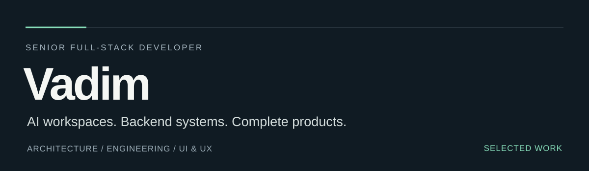
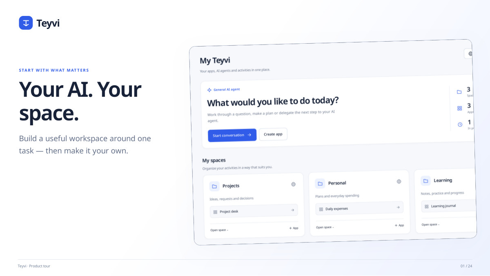
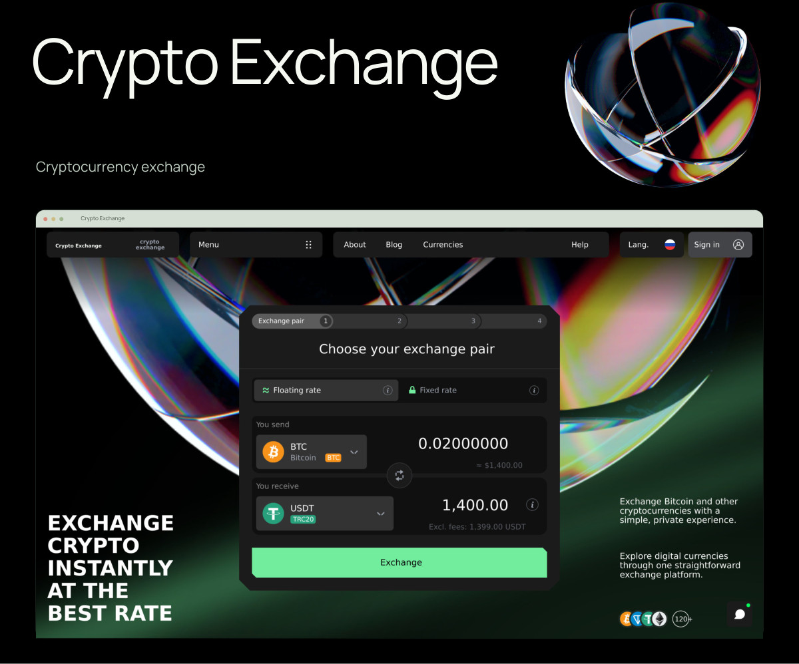
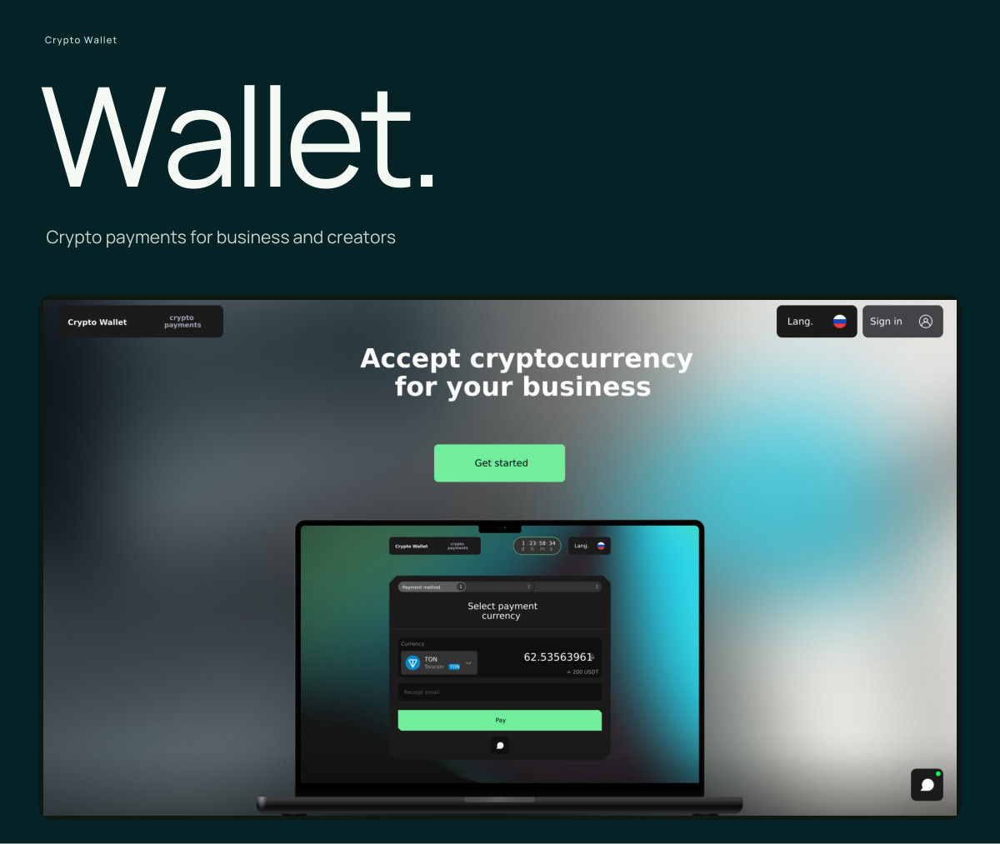

I design and build software end to end: architecture, backend, integrations, frontend and UI/UX. My focus is AI workspaces, business automation and products with complex backend logic.

**[Work with me on Upwork](https://www.upwork.com/freelancers/~014914b157aacf24f3)** · [Selected work](#selected-work) · [PDF portfolio](portfolio/README.md) · [Technical background](#technical-background)

## Selected work

### 01 / Teyvi
**Personal AI workspace & automation platform**

A visual SaaS platform where users build their own apps, data models, pages and forms, then connect AI agents and tools to the work.

- Visual app builder, reusable blueprints and a plugin SDK
- AI APIs, Codex and Claude Code task connectors, plus local and remote MCP
- Scoped tool permissions, plan review, approvals and tracked task results

**My role:** Solo full-stack development, architecture and AI integrations.  
**Core stack:** Go · Next.js · MCP

**[View the 24-page product tour](portfolio/Teyvi-EN.pdf)**

---

### 02 / Crypto Exchange
**Automated cryptocurrency exchange platform**

Built from scratch, from responsive customer interfaces to backend order processing, rate handling, external integrations and transaction status tracking.

**My role:** Architecture, backend, frontend and UI/UX.  
**Core stack:** TypeScript · NestJS · Next.js · PostgreSQL · Redis · NATS

**[View the visual presentation](portfolio/Crypto-Exchange-EN.pdf)**

---

### 03 / Crypto Wallet
**Payment platform for businesses & creators**

A merchant workspace for payment links, invoices, transaction history and account settings, connected to backend services and payment APIs.

**My role:** Architecture, backend business logic, frontend, integrations and UI/UX.  
**Core stack:** Node.js · TypeScript · NestJS · React · Next.js

**[View the visual presentation](portfolio/Crypto-Wallet-EN.pdf)**

---

### 04 / Telegram Wallet & Exchange
**Mini App & bot**

A crypto wallet and automated exchange inside Telegram. Users receive assets, exchange currencies, track order status and get bot notifications in the same experience.

**My role:** End-to-end product development, backend logic, wallet and exchange integrations, frontend and UI/UX.  
**Focus:** Telegram Mini App · Bot · Wallet integrations · Exchange workflows

**[View the visual presentation](portfolio/Telegram-Wallet-Exchange-EN.pdf)**

## Technical background

**Backend & systems**  
Node.js · TypeScript · Go · NestJS · REST · gRPC · WebSockets · Kafka

**Data & infrastructure**  
PostgreSQL · MongoDB · Redis · NATS · BullMQ · Docker · CI/CD

**Frontend & AI**  
React · Next.js · MCP · AI agents · LLM integrations · RAG · pgvector

## How I work

I take ownership from understanding the problem and designing the architecture through implementation, testing and deployment. I use Claude Code and Codex in development, while personally reviewing architecture, business logic, security and the final result.

**[Discuss a project on Upwork](https://www.upwork.com/freelancers/~014914b157aacf24f3)**

Visual presentations and technical overviews are public. Commercial source code, credentials and private integrations are not included.
