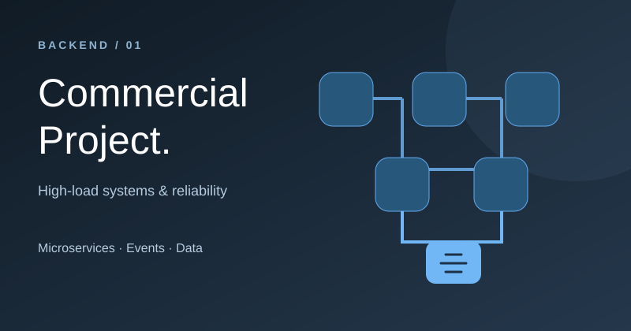
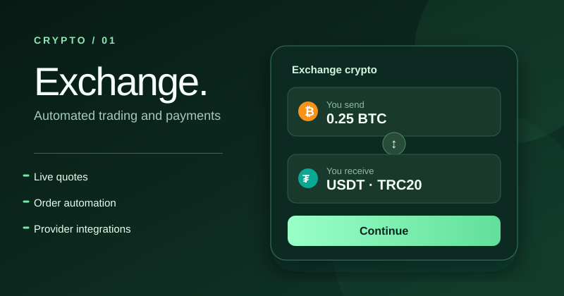
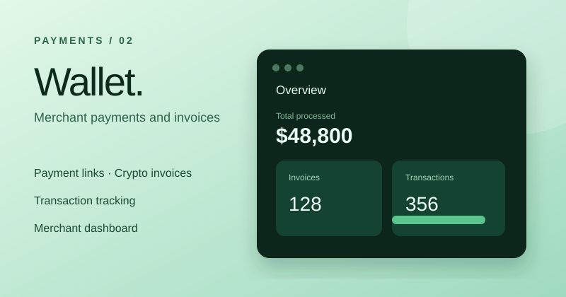
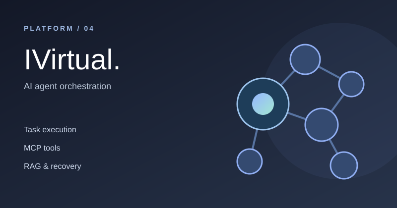

# Vadim Burukhin

**Senior Backend Developer** · Node.js / NestJS / TypeScript / Go

I build production backends, integrations and complete web products. My focus is reliable business logic, distributed systems and getting software into production.

### Selected work

<table>
<tr>
<td width="50%" valign="top">

<h3>Commercial Project</h3>

High-load backend · microservices · event-driven workflows · idempotency.

<a href="case-studies/retail-fulfillment.md">View case study →</a>
</td>
<td width="50%" valign="top">

<h3>Crypto Exchange</h3>

Automated exchange engine, live quotes, deposits, trades, withdrawals and operator tools.

<a href="case-studies/crypto-exchange.md">View case study →</a>
</td>
</tr>
<tr>
<td width="50%" valign="top">

<h3>Crypto Wallet &amp; Payments</h3>

Merchant dashboard, crypto invoices, payment flows and transaction tracking.

<a href="case-studies/crypto-payments.md">View case study →</a>
</td>
<td width="50%" valign="top">

<h3>IVirtual</h3>

Self-hosted agent orchestration, model integrations, MCP tools and retrieval.

<a href="case-studies/ivirtual.md">View case study →</a>
</td>
</tr>
</table>

### What I work with

**Backend:** Node.js · NestJS · TypeScript · Go · REST · gRPC  
**Data & messaging:** PostgreSQL · MongoDB · Redis · Kafka · NATS · RabbitMQ · BullMQ  
**Full-stack & delivery:** React · Next.js · Docker · CI/CD · Linux · Grafana

### A bit about me

I work across architecture, implementation, testing and deployment. My background in systems and network engineering helps me approach applications as complete production systems — not just code.

[Infrastructure automation](https://github.com/vadimoarturo/Autocheck-WSR-NSA) · [JavaScript UI project](https://github.com/vadimoarturo/Excel-NativeJs)

---

*Selected commercial source code is private. The linked case studies describe the work without publishing proprietary implementations.*
