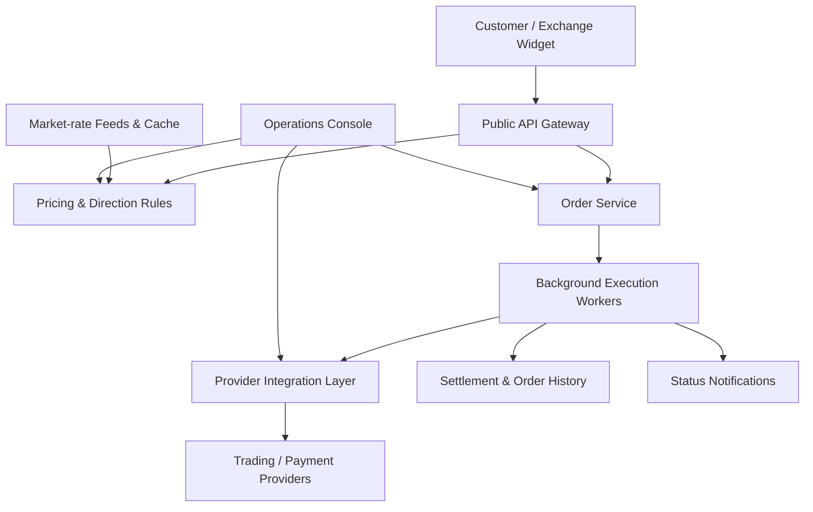

# Automated Cryptocurrency Exchange Platform

**Scope:** Customer exchange websites, embeddable exchange widget, multi-service backend, partner APIs and operator console.  
**Contribution:** Backend architecture, integration workflows and full-stack product development.  
**Source code:** Private. This is a public system-design case study.

## What was built

A cryptocurrency exchange ecosystem supporting fixed and floating quotes, configurable currency/network directions, provider liquidity, automated order execution, payouts, referral accounting, and operator oversight.

Unlike a simple front-end calling a trading API, this system handles the **entire exchange lifecycle**, including transaction-state transitions and financial settlement across external services.

## End-to-end order lifecycle

1. **Rate discovery and quoting:** A customer selects source and destination assets, chains and amount. The pricing service calculates a quote from cached external market rates, exchange direction settings, fees, precision, network costs and configured limits.
2. **Server-side quote validation:** Authoritative calculation context is retained on the backend rather than trusting client-submitted price data.
3. **Order creation:** The API validates the session and request, performs abuse/blacklist checks, chooses a suitable provider account, obtains deposit instructions and saves the initial order state.
4. **Deposit confirmation:** An asynchronous worker monitors incoming funds and the required confirmations, recording progress.
5. **Risk checks:** The workflow performs applicable blockchain and AML validations before proceeding.
6. **Provider-side trade:** The execution service places the necessary trade with a provider and monitors the result, including intermediate states and failures.
7. **Customer withdrawal:** After trading completes, the system initiates a destination-network withdrawal and tracks confirmation.
8. **Financial settlement:** It accounts for provider/platform fees, residual balances, referral activity, operational logs and final order status.
9. **Exception handling:** Operators can review detailed execution history and intervene in eligible manual/recovery workflows.

## Why the system is responsive

**Market-rate caching.** Pricing does not need a synchronous external exchange API request for every user interaction. Price feeds are collected separately and made available to the quote engine.

**Asynchronous execution.** Blockchain confirmations, external trades and withdrawals take time. Background workers process these stages without keeping frontend HTTP requests open.

**Independent business services.** Rates, pricing, account management, order execution, authentication, notification delivery and administration have distinct responsibilities.

**Explicit financial state.** Orders retain provider identifiers and stage/status information. Diagnosing and recovering a stalled money-moving operation requires verifying the external provider's actual state rather than blindly resending the request.

**Operational controls.** Exchange directions, limits, fees, currency networks, provider accounts and promotional settings can be managed without rebuilding the entire system.

Actual exchange completion time depends on the chosen blockchain, confirmation policy, external execution and withdrawal processing; no guaranteed end-to-end speed is implied.

## Features and surrounding applications

- Fixed and floating quotes, forward and reverse calculations
- Currency and blockchain-network configuration
- Customer websites and embeddable exchange widget
- Partner/referral accounts, commissions and signed integration APIs
- Admin dashboards for order histories, financial analytics, provider accounts and balances
- Manual trading and operational recovery controls
- Payment notifications and customer order-status tracking
- Monitoring-site listings and BestChange competitor-rate tracking with promotional pricing adjustments

## Provider architecture and implementation boundaries

The reviewed system includes exchange execution integrations with **KuCoin** and **BPay**, with an additional **OKX market-data implementation** present in the code. Execution support and market-data support are different capabilities; any additional deployed integrations must be verified separately.

The adapter/service architecture supports extension to other providers without rewriting the customer-facing lifecycle.

## Stack

NestJS, TypeScript, PostgreSQL, Prisma, Redis, NATS, BullMQ, Next.js, React, Go and Docker.

*Private code, provider keys, client data, domain information and financial account details are intentionally omitted.*