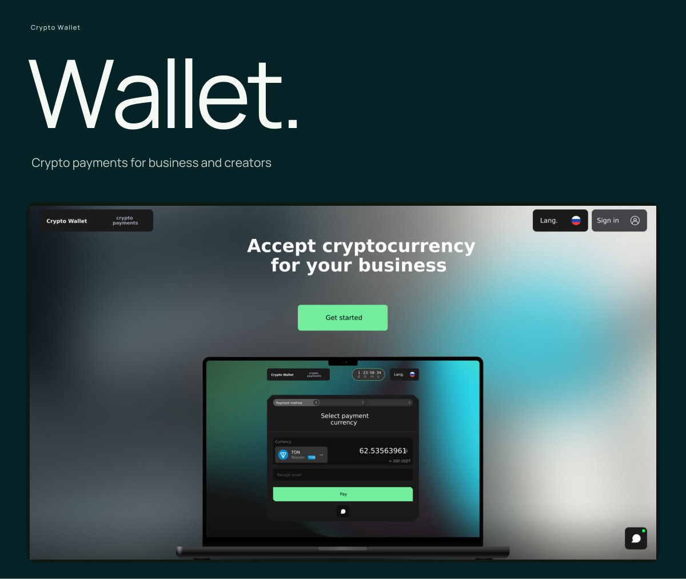
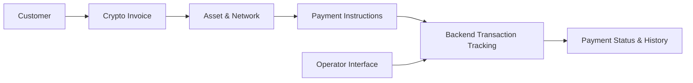

# Crypto Wallet Payment Platform

**[View the full visual presentation](../portfolio/Crypto-Wallet-EN.pdf)** · [Back to portfolio](../README.md)

**Scope:** A merchant payment platform for businesses and creators.  
**Contribution:** Architecture, backend business logic, frontend, payment integrations and UI/UX.  
**Source:** Private.

## Product overview

A crypto payment platform built around a merchant dashboard, payment links, invoices, transaction history and account settings. I independently built the product and connected its checkout interfaces with backend services and payment APIs.

## Customer payment journey

1. Create or open a payment request/invoice.
2. Select a supported asset and blockchain network.
3. Present the correct network-specific payment instructions.
4. Track the associated payment and its asynchronous status changes.
5. Display completion, pending or exception states clearly to the customer.
6. Provide transaction history and operational visibility in the relevant interface.

## Product surfaces

- Merchant dashboard for managing checkouts and payment requests
- Payment links, cryptocurrency invoices and checkout interfaces
- Currency selection and payment status presentation
- Transaction history and account settings
- Integration with backend transaction and payment workflows

The separate [Telegram Mini App and bot](telegram-mini-app.md) has its own visual presentation and case study.

## Engineering considerations

- Keeping invoice state separate from on-chain transaction state
- Correct identification of assets and transfer networks
- Clear handling of delayed confirmations and provider failures
- Avoiding duplicate actions and exposing reliable status to customers
- Practical operator visibility into payment issues

## Technology

Node.js, TypeScript, NestJS, React, Next.js and supporting payment integrations.

*The presentation shows the customer and merchant experience. Commercial source code, provider credentials and private integrations are not included.*
