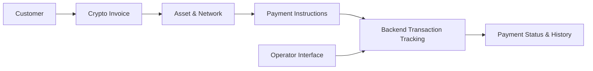

# Crypto Wallet & Payment Experiences

**Scope:** Cryptocurrency wallet-oriented interfaces and invoice/payment workflows across customer applications.  
**Contribution:** Backend integrations, transaction status flows and frontend development.  
**Source:** Private.

## Product overview

Cryptocurrency payment and wallet experiences built around invoice-style flows, chain-specific payment details, customer-facing status updates and operational visibility.

## Customer payment journey

1. Create or open a payment request/invoice.
2. Select a supported asset and blockchain network.
3. Present the correct network-specific payment instructions.
4. Track the associated payment and its asynchronous status changes.
5. Display completion, pending or exception states clearly to the customer.
6. Provide transaction history and operational visibility in the relevant interface.

## Product surfaces

- Cryptocurrency invoice and payment user interface
- Responsive web application and wallet-oriented user experience
- Network selection and payment status presentation
- Mobile-first wallet interfaces, including a Telegram Mini App product
- Integration with backend transaction and payment workflows

## Engineering considerations

- Keeping invoice state separate from on-chain transaction state
- Correct identification of assets and transfer networks
- Clear handling of delayed confirmations and provider failures
- Avoiding duplicate actions and exposing reliable status to customers
- Practical operator visibility into payment issues

## Technology

Node.js, TypeScript, NestJS, React, Next.js and supporting payment integrations.

*This overview presents documented product features without claiming that every screen is a separately deployed payment integration. Provider credentials and user transactions are not public.*