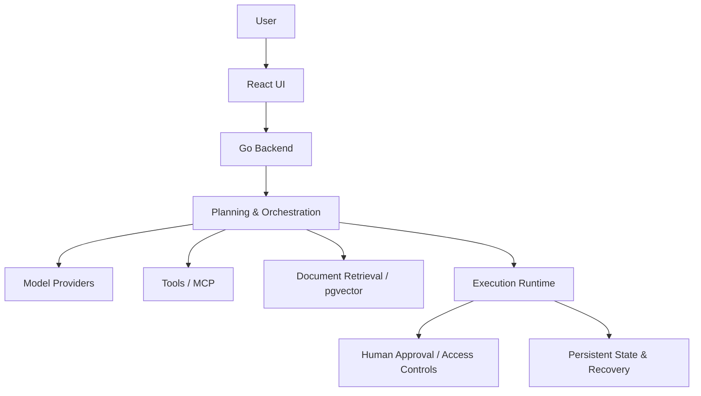

# IVirtual — Self-Hosted AI Agent Platform

**Scope:** AI-agent orchestration, multiple model integrations, controlled tool execution and retrieval-augmented context.  
**Contribution:** Architecture, Go backend and React user interface.  
**Source:** Private.

## Overview

IVirtual is a self-hosted platform for coordinating complex AI-assisted engineering work. It manages tasks, agents, model providers, tools and documents through a structured workflow rather than a simple conversational interface.

## Core capabilities

- Multi-stage task planning and orchestration
- LLM/provider integrations and tool calling
- Custom **MCP (Model Context Protocol)** integrations
- Document retrieval and vector context with PostgreSQL/pgvector
- Human approval points and configurable tool permissions
- Persistent task execution, progress inspection and recovery after interruption
- Web interface for reviewing task and execution states
- Docker-based deployment

## High-level architecture

## Key engineering decisions

**Recoverable execution:** Store enough state to inspect and resume interrupted workflows.

**Permission-aware tools:** Distinguish model-generated instructions from permitted, reviewable tool operations.

**Context management:** Augment task context with targeted retrieval instead of depending entirely on a single long prompt.

**Human-in-the-loop operation:** Make consequential actions subject to clear approvals or access rules.

**Observable workflows:** Expose intermediate execution progress and failures to help investigate and recover problems.

## Technology

Go, React, PostgreSQL, pgvector, AI model provider integrations, MCP and Docker.

> This is a public architectural overview. The complete orchestration code, private prompts, deployment credentials and user data are not included.