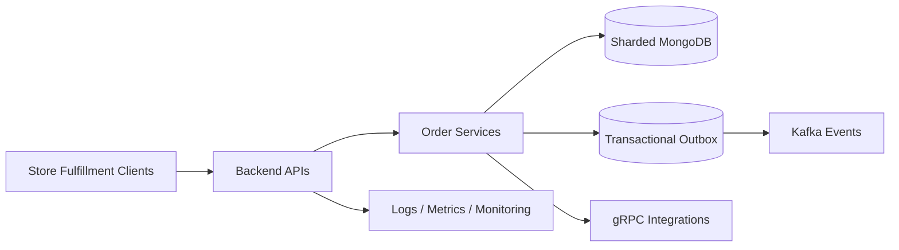

# Commercial Project

**Context:** Commercial Project.  
**Role:** Senior Backend Developer  
**Areas:** Backend architecture, microservices, order workflows, event-driven integration and production support.  
**Code:** Private.

## Business and engineering context

An order-fulfillment backend coordinates inventory operations, product scanning, substitutions, order-state changes and asynchronous downstream services. Performance and correctness matter when users operate with unreliable connections and request retries.

This case study describes engineering contributions **at a high level**, with the organization and identifiable operational details intentionally omitted.

## My contribution

### Microservice delivery

I designed and brought a new backend service into production as part of a transition away from a monolith. This involved discussing and defending architecture decisions, implementing service boundaries and integrating a sharded MongoDB environment.

### Product scanning and idempotency

I worked on redesigning product-scanning workflows, reducing unnecessary API calls and moving state handling to the server. Idempotency is critical here: a repeated request caused by a weak connection must not produce repeated business actions.

### Reliable business events

I worked with gRPC and Kafka integration patterns and implemented **Transactional Outbox**, helping align database changes with reliable publication of domain events.

### Workflow troubleshooting

I improved substitution and alternative-product logic and investigated production issues across service boundaries. The work included tracing behavior through APIs, database operations, asynchronous processing and monitoring.

## Conceptual architecture

*Illustrative components and relationships; not a private deployment diagram.*

## Engineering principles demonstrated

- Production implementation within an established high-traffic system
- Evolving a monolith into independently deployable services
- Maintaining correctness under intermittent connectivity and retries
- Clear ownership of domain state and reliable event delivery
- Performance investigation, observability and operational responsibility

**Technology:** Node.js, TypeScript, NestJS, Go, MongoDB, Kafka, gRPC, Redis, Docker, monitoring tooling.

> No employer code, credentials, internal endpoints, production topology or customer data are included.