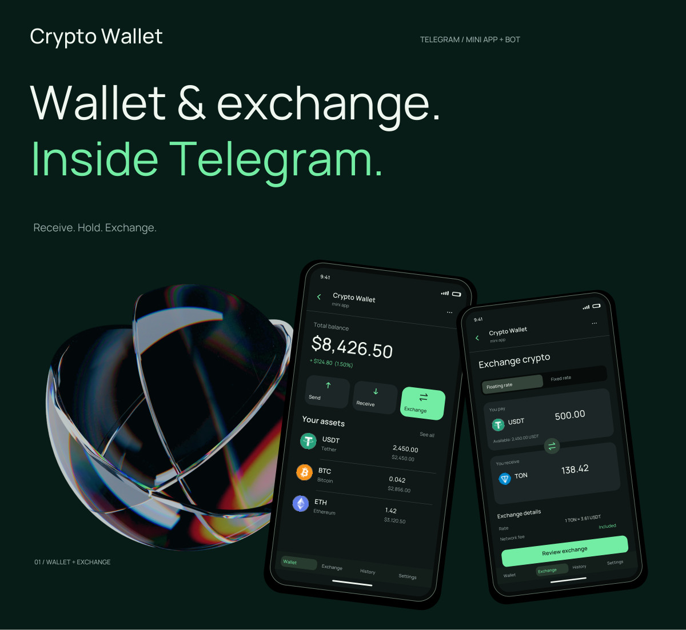

# Telegram Wallet & Exchange

**Crypto wallet, automated exchange, Mini App and bot**

**[View the full visual presentation](../portfolio/Telegram-Wallet-Exchange-EN.pdf)** · [Back to portfolio](../README.md)

## Overview

A Telegram Mini App and bot that bring a crypto wallet, exchange flow and order updates into one experience.

**My role:** I independently built the product, owning the architecture, backend business logic, wallet and exchange integrations, frontend and UI/UX.

## Product flow

1. **Open the wallet:** Review assets and navigate between wallet, exchange, history and settings.
2. **Receive cryptocurrency:** Select an asset and network, then view a deposit address and QR code.
3. **Exchange assets:** Select currencies, review the amount and rate, and submit an exchange request.
4. **Track the order:** Follow progress and completion inside the Mini App.
5. **Stay informed:** Receive deposit and exchange notifications through the Telegram bot.

## What I built

- Mobile-first wallet and exchange interfaces
- Backend business logic and API integration
- Wallet and automated exchange workflows
- Order status and history views
- Telegram bot notifications linked to the product experience

## Engineering focus

The wallet, exchange and bot share a connected product flow. Backend status changes are reflected in the interface and notifications so users can follow the same order across both surfaces.

The presentation includes wallet screens, receiving details, exchange status and bot messages. It is a visual product walkthrough, not a performance or trading-results report.

[Open the full presentation](../portfolio/Telegram-Wallet-Exchange-EN.pdf)

Commercial source code, provider credentials and private integrations are not included.
