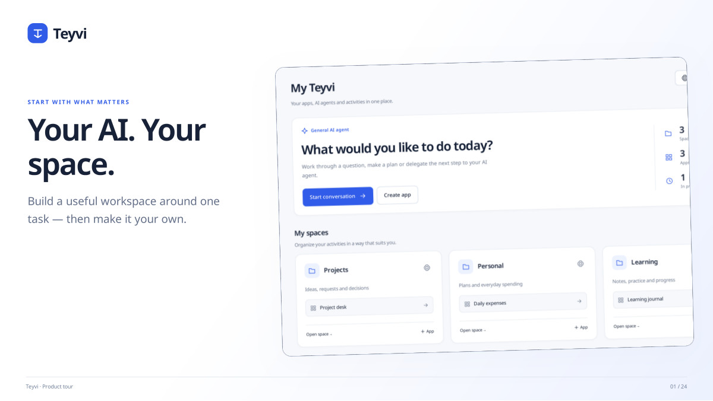
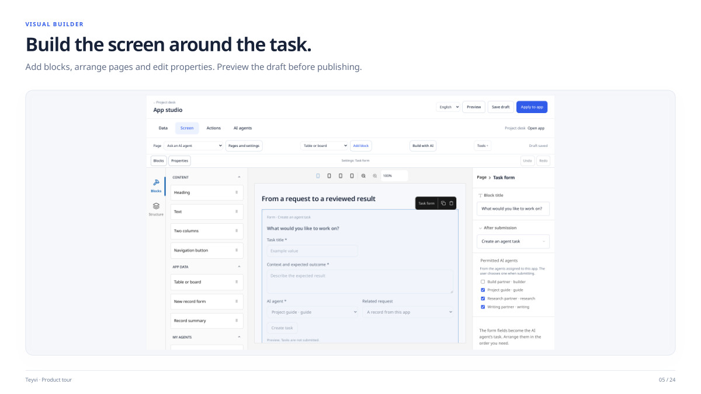
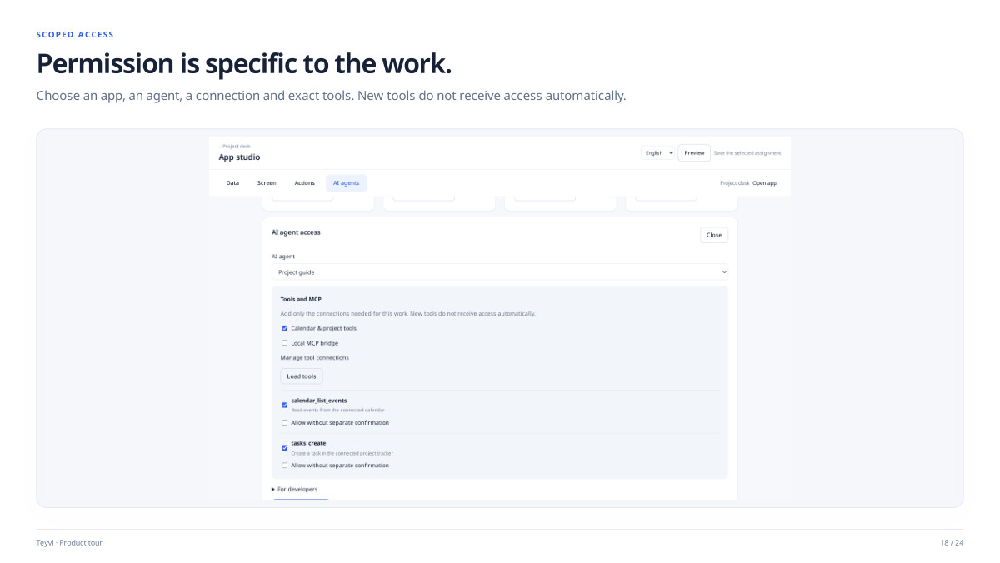
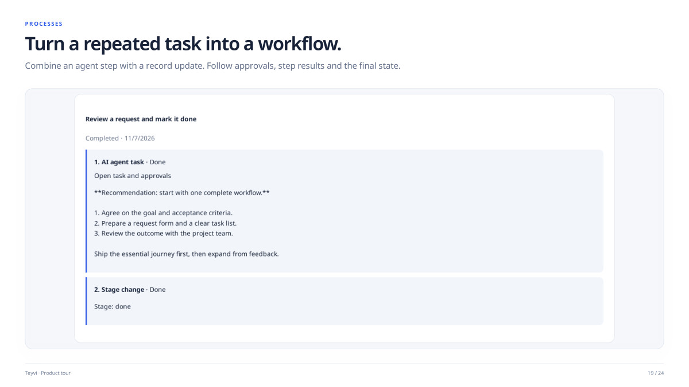

# Teyvi

**Personal AI workspace & automation platform**

**[View the complete 24-page product tour](../portfolio/Teyvi-EN.pdf)** · [Back to portfolio](../README.md)

## Overview

Teyvi is a visual SaaS platform for building personal AI workspaces. A user creates a space, adds apps and data, designs pages and forms, then assigns agents and connected tools to specific tasks.

**My role:** Solo full-stack developer. I designed and built the architecture, Go backend, Next.js interface and AI integrations, including automated tests and production deployment.

## Build the workspace

Users define fields, types and stages, then work with the same app data through forms, tables and boards. The visual builder lets them arrange blocks, edit properties and preview a draft before publishing it.

Reusable blueprints carry an app's fields, pages, role descriptions and rules. Accounts and permissions are connected separately after import. AI-assisted app creation follows a reviewable proposal and draft workflow.

## Connect AI and tools

- Compatible AI APIs for chat and task execution
- Codex with a ChatGPT account and Claude Code through task connectors
- Remote MCP services and a local MCP bridge
- App-specific agents with instructions, models and connections
- A plugin SDK for typed capabilities, schemas, widgets and optional language dictionaries
- Interface and plugin localization, with English as the default

## Keep access and decisions visible

Permissions are scoped to an app, an agent, a connection and exact tools. Newly discovered tools do not receive access automatically. Users can inspect plans and approve or reject proposed tool actions.

## Follow the work through to a result

Requests become tracked tasks. Plans, approvals, progress, results and history remain available together. Workflows combine agent steps with record updates so the user can follow each step and its final state.

## Technology

Go · Next.js · AI API integrations · MCP · Codex and Claude Code task connectors · Plugin SDK

## Presentation guide

- **Pages 1-8:** Spaces, app creation, data, visual builder and forms
- **Pages 9-15:** Agents, plan review, results, conversations and approved actions
- **Pages 16-20:** Model sources, MCP, permissions, workflows and blueprints
- **Pages 21-24:** Personal apps, AI-assisted building, extensions and product overview

[Open the full product tour](../portfolio/Teyvi-EN.pdf)

This case study describes the published product presentation. Private implementation details, credentials and user data are not included.
