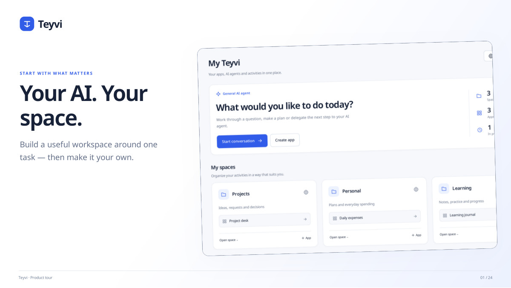
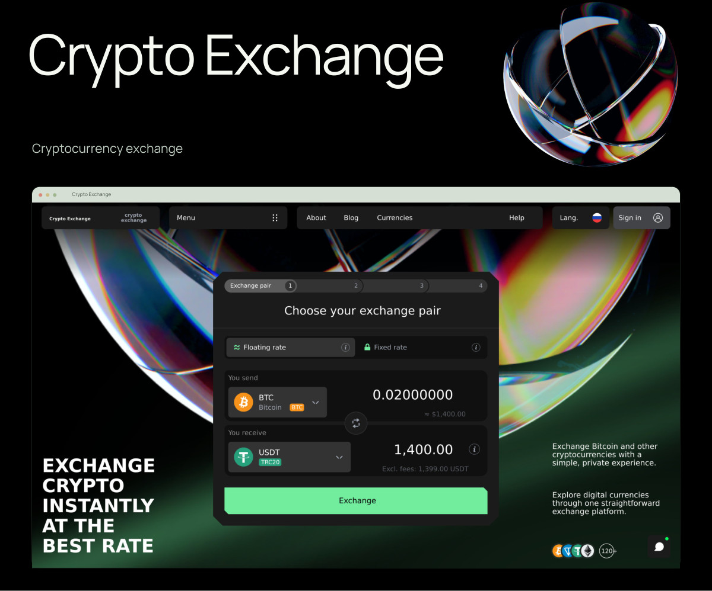
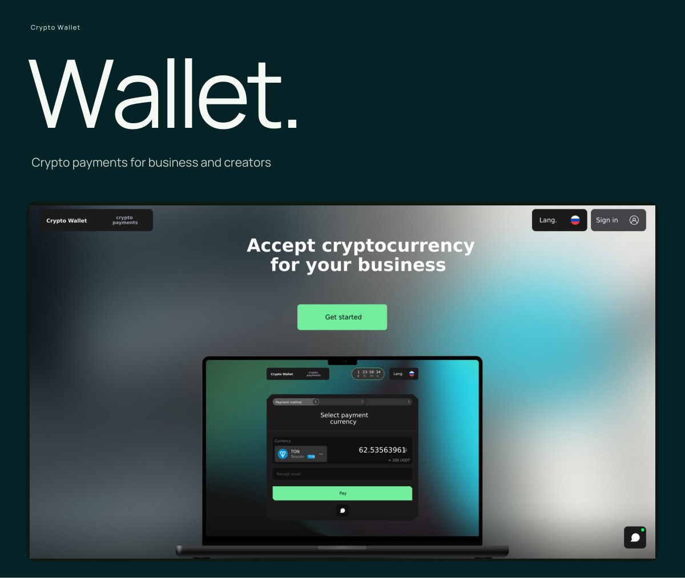
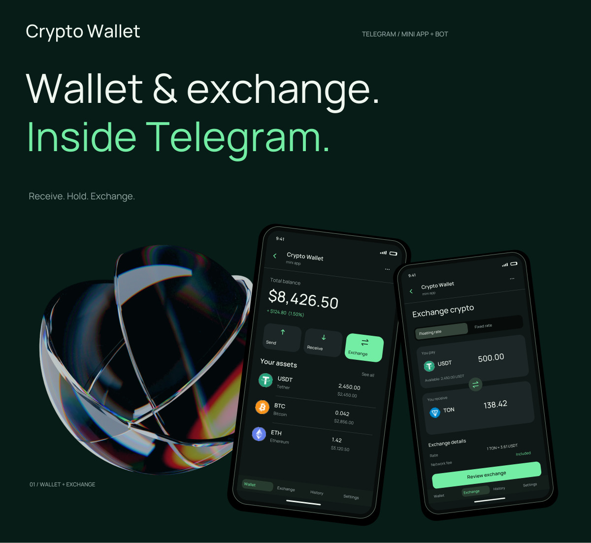

# Visual portfolio

The four English-language presentations below accompany the projects published on my [Upwork profile](https://www.upwork.com/freelancers/~014914b157aacf24f3).

## Teyvi

Visual app builder, data models, AI agents, MCP tools, approvals and reusable workflows.

**[Open PDF](Teyvi-EN.pdf)** · 24 slides · 6.1 MB

## Crypto Exchange

Responsive exchange interface, mobile screens, order flow and customer workspace.

**[Open PDF](Crypto-Exchange-EN.pdf)** · Long-format presentation · 2.5 MB

## Crypto Wallet

Merchant dashboard, invoices, checkout, transaction history and account settings.

**[Open PDF](Crypto-Wallet-EN.pdf)** · Long-format presentation · 2.0 MB

## Telegram Wallet & Exchange

Wallet and exchange screens, receiving flow, order tracking and bot notifications.

**[Open PDF](Telegram-Wallet-Exchange-EN.pdf)** · Long-format presentation · 1.0 MB

---

All PDFs are stored in this repository. If GitHub's preview is unavailable, use the file page's download button. The three long-format presentations are best viewed at fit-to-width.

[Back to the main portfolio](../README.md)
